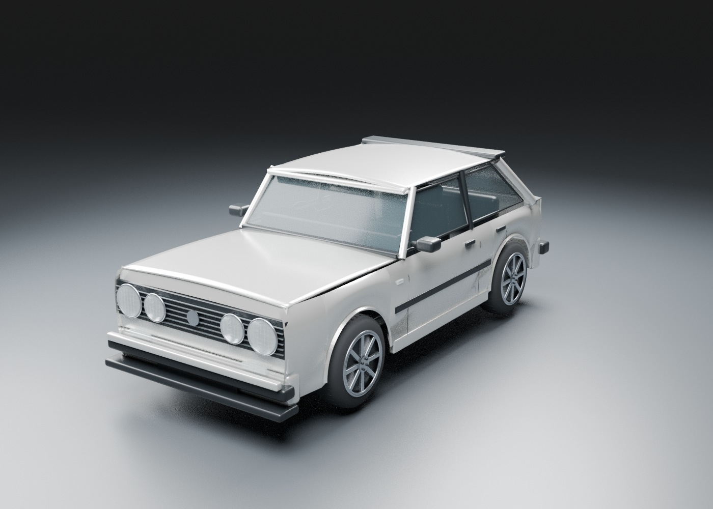

# Scrapline: Built to Race

A mobile-first 3D drag racing and car restoration game. Find abandoned cars, dismantle assemblies, salvage components, build a personalized car, and prepare for the next race with an AI mechanic.

## Project status
Early garage prototype implemented in Godot, with an original reference-guided car model. This is a geometry and interaction study; final vehicle art and phone performance validation remain pending.

Open `game/project.godot` in Godot 4.6. See [garage study, controls, and validation](docs/GARAGE_STUDY.md).

## Core loop
Explore → recover → inspect → dismantle → repair/adapt → customize → tune → race → improve the workshop.

## Design pillars
- Deep visual and mechanical customization.
- Parts have distinct roles, compatibility requirements, wear, and performance effects.
- Salvaging a damaged assembly can yield useful components for another build.
- Driving skill matters: launch, traction, throttle, shifts, and gearing.
- The AI mechanic explains simulation-backed faults and repairs using actual inventory and telemetry.
- Strong mobile visuals and stable performance must be demonstrated on a Samsung Galaxy A14 early.

## Planning
- [Game design](docs/GAME_DESIGN.md)
- [First playable and acceptance criteria](docs/FIRST_PLAYABLE.md)
- [Development roadmap](docs/ROADMAP.md)

## Development approach
Finish and verify one milestone before expanding. Start with a visual and performance proof, then implement the complete salvage-to-race loop. Engine selection is pending a device-tested prototype. Use original or appropriately licensed assets and maintain an asset register.

## Mobile browser playable (alpha v0.2)

**Play:** https://scrapline-web-production.up.railway.app/

The browser build is a first playable quarter-mile drag race / interactive garage prototype, separate from the Godot garage study.

- Garage: drag/touch orbit, pinch zoom, paint, alloy finish, GLB file import with local IndexedDB persistence.
- Race: start light countdown, hold throttle, automatic or manual gear shifts, AI opponent, speed/RPM/gear/timer, quarter-mile finish, stored personal-best time, rematch and return to garage.
- Mobile browser: scalable UI, touch throttle and shift; keyboard also supports Space/Up throttle and E/Shift for shifting.
- Car models: the starter garage model is included; uploading a personal Volkswagen GLB on the device makes that model available in the browser and can be saved locally. The custom GLB is **not yet committed** as a shared repo asset and imported fixed mesh parts cannot necessarily open/animate/customize independently.
- Race physics, graphics and opponent behavior are alpha approximations, not yet a production simulation, true tire/engine setup or an optimized native game.
- Automated sanity check: `node tests/web_smoke.mjs`.

Hosting: `npm start` serves the `web/` UI plus `game/assets/` binaries. Railway deploys changes from `main`.

## Mobile 3D visual rebuild (v0.3, 11 Nov 2026)

The deployed browser game now uses an actual Three.js 3D scene, not a video or flat image. This update addresses screenshots from a phone:

- Player car: corrects the GLB off-origin rotation pivot that could move imported vehicles outside the chase camera.
- Camera: portrait-safe camera and selectable CHASE / SIDE / HOOD viewpoints.
- Track: 3D tarmac, pits, spectator seating, mountains, trees, cones, guardrails and trackside signs.
- Garage: improved workshop props, service bays, metallic reflections and ceiling lights.
- Materials: PBR updates for glass, tires and body panels; neutral reflections and soft ground shadows.
- UI: staging pole outside the race camera; GO notice fades and garage start button avoids the car.
- Mobile: dynamic light count and render resolution are capped.

Known limits: The user's Volkswagen GLB is only available through local import on each device, not permanently copied to the GitHub repo. Realistic mesh topology, UV/texture maps, detachable doors/bonnet, accurate physics and audio are future work. Smoke tests validate syntax and UI wiring but not phone rendering quality or FPS.

Play: https://scrapline-web-production.up.railway.app/
