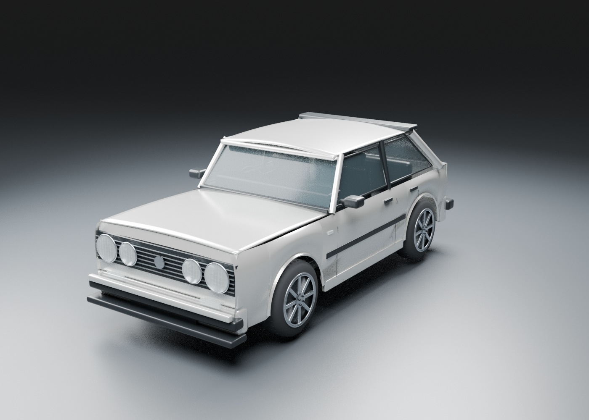
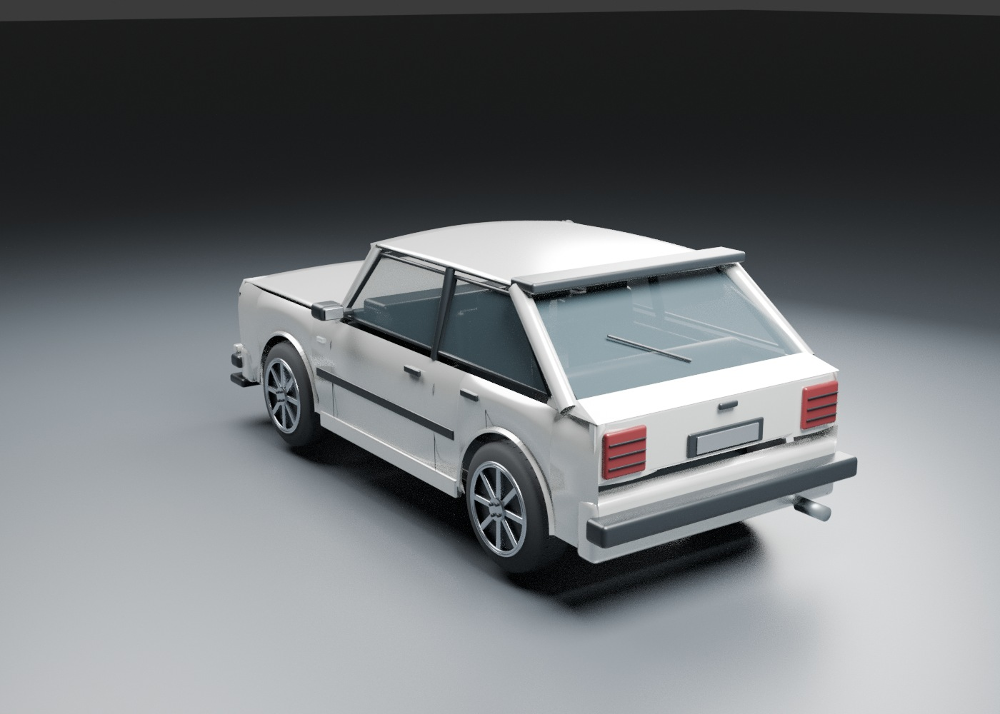

# Garage study 02 — body and materials pass

## November 10 rebuild pass
Replaced the flat box bonnet and roof with crowned panel meshes, added curvature to the body sides and taper at the nose/tail, tightened wheel fitment, closed the bonnet-front and roof-header gaps, and added transparent tinted glazing with an interior floor, door cards, steering wheel and rear bench. Headlights now have open bezel rings and reflector bowls. The original four/two-headlight switch, paint/wheel choices and bonnet interaction remain.

The Godot garage now has a reflected sky environment and clearcoat paint. Front/rear/engine camera buttons were corrected to face the named end of the car and front/rear presets reset zoom and elevation.

This is an incremental geometry pass. The vehicle is still visibly simplified and has **not reached the requested Need for Speed-like realism**. No final art acceptance, in-engine visual acceptance, Android performance result, or finished racing game is claimed. The next art work requires more accurate panel construction, bumpers, lamp lenses, cabin detail and textures; preserve independently customizable assemblies.

Validation for this pass: regenerated the runtime GLB; Godot 4.6.3 import and the garage smoke checks pass. Updated Blender front/rear renders show the committed model. An in-engine capture was attempted using a dummy X server, but this environment rejected display socket creation. These previews remain offline renders, not phone screenshots.

## Implemented
Original reference-guided 3D hatchback mesh, four-headlight front with selectable two-headlight alternative, rolled arches, black front/rear spoilers, smoked rear lamps, engine bay, machined wheels, paint and wheel finish changes, animated bonnet, orbit/zoom, and saved customization.

The user's four-headlight white car is the primary reference. Side and rear details are inferred from their description; this is not a scan or exact replica. The source photo has not been published in this public repository.

## Run
Open `game/project.godot` in Godot 4.6 or run `godot --path game` from the repository root. First import: `godot --headless --path game --editor --import --quit`.

Controls: drag outside the toolbar to orbit; mouse wheel or two-finger pinch to zoom. Toolbar includes front, rear, engine views, paint, alloy finish, headlight layout, and bonnet.

## Rebuild model
Run `blender -b --python tools/build_car.py -- "$PWD/game/assets"` from the repository root. The script creates the GLB, editable Blender source under `art/source`, and studio renders under `docs/previews`. Blender source is reproducible and excluded from git; the runtime GLB is committed.

## Validation
- Godot 4.6.3 headless asset import succeeds.
- Garage scene instantiates without script errors.
- Smoke checks verify material lookup, exclusive 2/4-headlight visibility, bonnet movement, and customization save/load.
- Command: `godot --headless --path game --script res://tests/garage_smoke.gd`. Run with a disposable user-data directory; it restores default colors/layout after testing.
- Front and rear Blender renders inspected; a gap below the rear glass was identified and repaired.
- Studio renders show the actual model, but are offline Blender renders, not evidence of mobile rendering quality.

## Remaining before visual milestone acceptance
This is an early geometry and interaction study, not final high-quality vehicle art. Refine body curvature, panel joins, lamp lenses, materials, interior, and photo matching. Review the rendered Godot scene interactively; the execution environment did not expose a display server for the automated in-engine capture. No device FPS, thermal, memory, Android APK, or phone graphics validation is claimed. Optimize draw calls and profile the real Galaxy A14 before expanding.

Godot Compatibility is used for this prototype as an experiment, not a final engine decision. Racing, salvage gameplay, mechanical fitting, and AI mechanic are not implemented yet.

